# Campus Care: University Maintenance and Service Requests

**Course:** MIT 8333 — Advanced Web Application Development (Virtual lab)

**Academic session:** 2026/2027

**Student name / matriculation number:** To be supplied

**GitHub repository:** [seyi-js/mit-ass](https://github.com/seyi-js/mit-ass)

**Application source commit:** [34a6b80](https://github.com/seyi-js/mit-ass/commit/34a6b80a4dfcf702203ddbc80e141a8792c3c862)

**Live application:** Pending hosting selection and deployment

## 1. Introduction and problem statement

University maintenance complaints often arrive through phone calls, paper forms,
WhatsApp messages, and office visits. Fragmented records make it difficult to
know who is responsible for a fault or whether a repair has been completed.
Campus Care provides one application for recording, assigning, tracking, and
reporting maintenance requests from students and staff.

## 2. System objectives

- Provide a consistent way to submit and track a maintenance request.
- Assign responsibility to an identifiable maintenance officer.
- Record progress and completion with named actors and timestamps.
- Give administrators user management, request monitoring, and reports.
- Enforce access by role and ownership and retain records in a database.

## 3. Requirement analysis

The implementation follows the supplied assessment brief. The detailed mapping
is in [requirements.md](requirements.md). Student and staff users register and
submit requests. Administrators create officer accounts and assign requests.
Officers view current assignments, record work in progress, and mark completion.
Administrators can view all requests and generate status/category reports for a
submission-date range.

The chosen four advanced features are session authentication, role-based access
control, search/filter/pagination, and Swagger API documentation. Status and
assignment history satisfy the required database entities. No email, uploads,
real-time functionality, or export feature is included in the application scope.

## 4. Frontend technologies

React and TypeScript provide the component-based interface. React Router maps
pages to role-restricted navigation. Vite builds the client and proxies local API
calls during development. Responsive CSS adapts the sidebar, forms, dashboard,
and tables to desktop and mobile screens. Lucide supplies interface icons.

Major interfaces are registration/login, role dashboards, request list with
search and filters, submission/edit form, request detail/history, user management,
and administrator reports. Forms use labelled native controls with length and
required-field validation. API failures and successful saves are shown visibly.
Private routes require a session; the backend remains the authority for access.

## 5. Backend technologies

NestJS exposes a REST API under `/api`. TypeORM provides PostgreSQL data access
and versioned migrations. DTOs with class-validator reject invalid or unexpected
input. Global authorization guards load the current account from the database
on every authenticated request and check role restrictions.

Passwords use Node.js scrypt with a random 16-byte salt and 64-byte derived key.
Only hashes are stored; password hashes are excluded from normal user queries.
Express sessions are stored in PostgreSQL with an eight-hour cookie lifetime.
Login regenerates the session identifier; logout destroys the session. Cookies
are HttpOnly, SameSite=Lax, and Secure in production. Browser writes verify the
configured Origin and require JSON. Helmet provides security headers, and rate
limits protect API and authentication endpoints.

Requests move through Submitted → Assigned → In progress → Completed. Database
transactions and row locks prevent duplicate transitions and preserve consistent
assignment history. Reassignment closes the previous assignment. User management
protects the last active administrator and officers with unfinished requests.

## 6. Database and relationships

PostgreSQL stores the following required entity groups:

| Entity              | Purpose and relationships                                                                                                       |
| ------------------- | ------------------------------------------------------------------------------------------------------------------------------- |
| Roles               | One role has many users; each user has one current role.                                                                        |
| Users               | One user can submit many requests, receive many assignments, and author many status logs.                                       |
| Service Requests    | Each request belongs to one requester and category; it has zero or one current officer, many assignments, and many status logs. |
| Request Categories  | One category has many requests. Six categories cover the faults listed in the brief.                                            |
| Assignments         | Each assignment links one request, one officer, and the assigning administrator; records start and end timestamps.              |
| Status Updates/Logs | Each entry links a request and acting user to a status, note, and timestamp.                                                    |

The database supports one-to-many relationships through foreign keys and a
historical many-to-many relationship between officers and requests through
assignments. A partial unique index permits only one active assignment per
request. The current officer is stored on the request for access checks and list
queries, and is updated transactionally with assignment records. Foreign keys
preserve referential integrity. Deleting a submitted request cascades to its
dependent history records. A separate sessions table supports authentication.

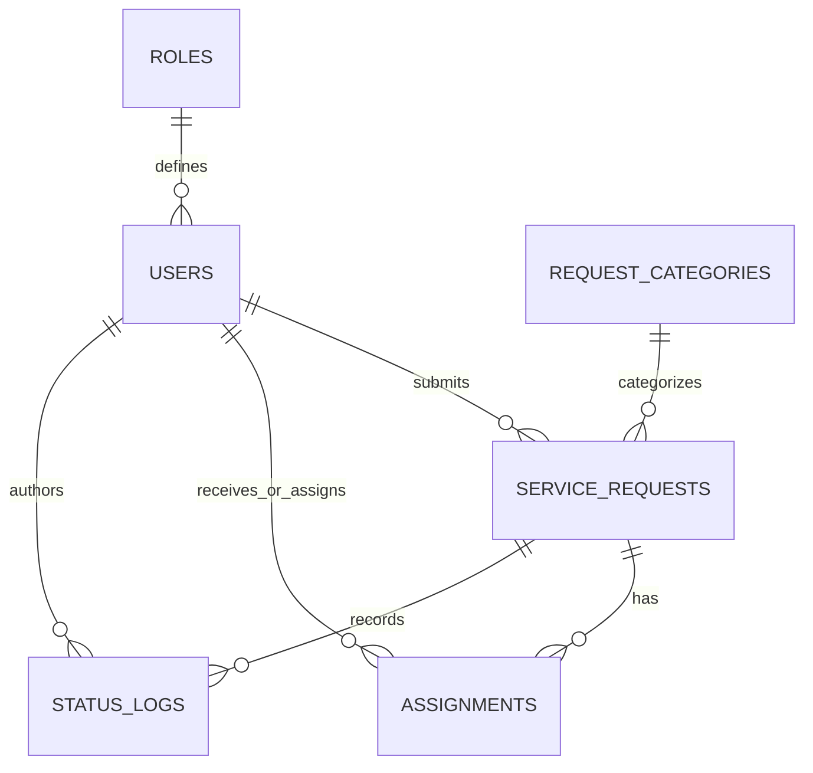

## 7. API documentation

[api-contract.md](api-contract.md) describes operations, request fields,
authentication, roles, status transitions, pagination, and failure responses.
The application exposes interactive Swagger documentation at `/api/docs` and
the OpenAPI document at `/api/docs-json`. A test-generated copy is saved in
[openapi.json](openapi.json).

API documentation is generated from NestJS controllers and DTOs. Integration
tests check that the documented endpoints exist and enforce the contract.

## 8. Screenshots of major interfaces

The browser workflow saves screenshots from the running application with a real
PostgreSQL test database. The names and records are synthetic demonstration data.

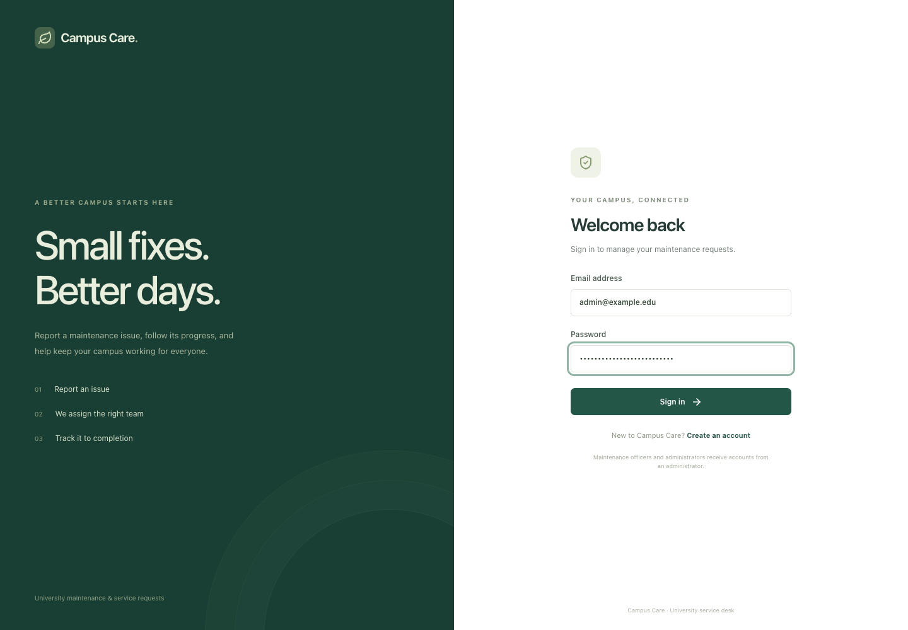

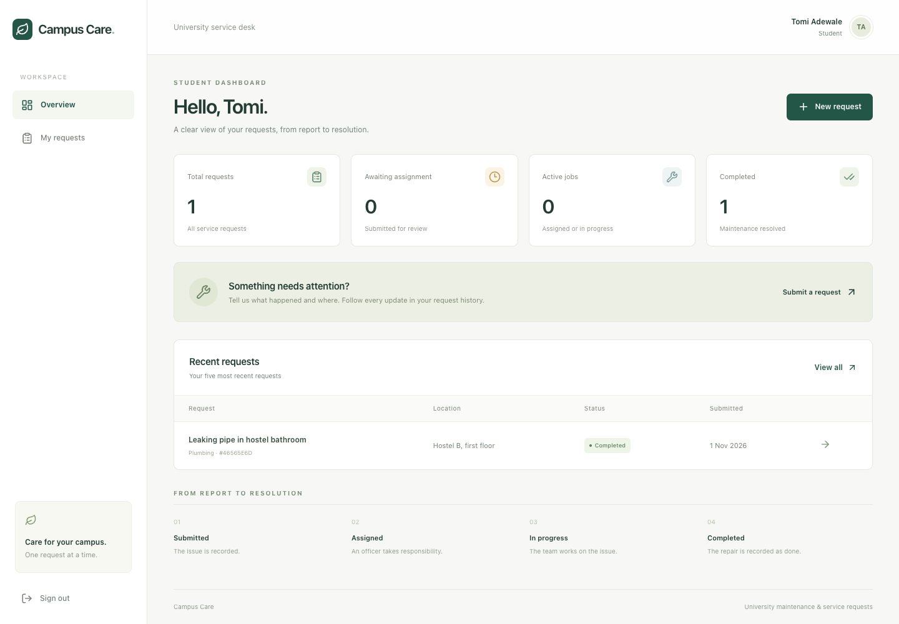

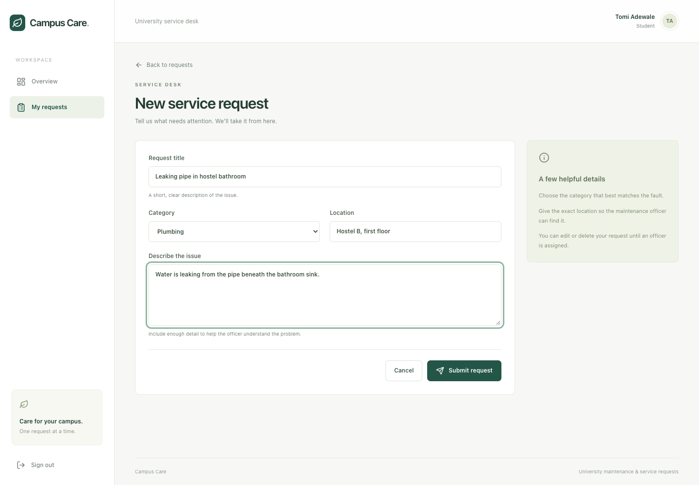

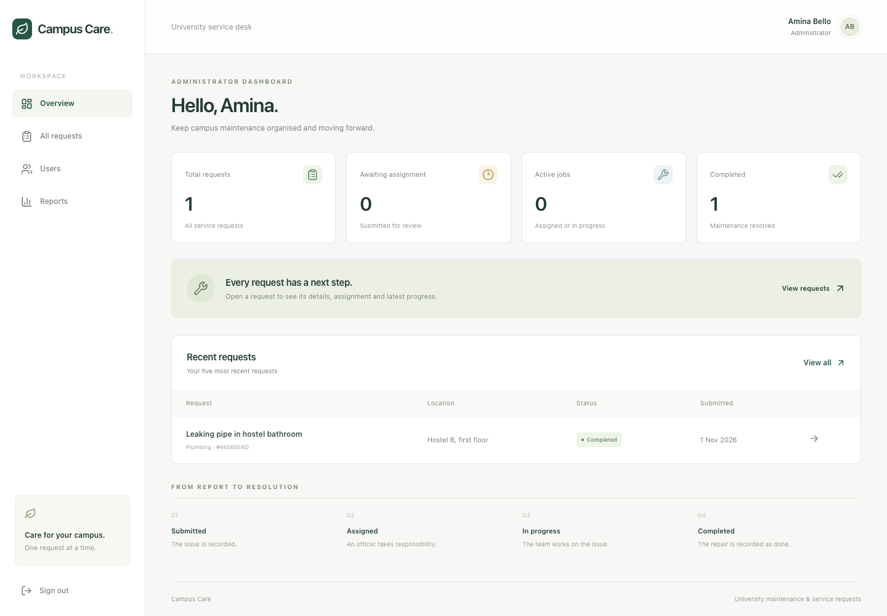

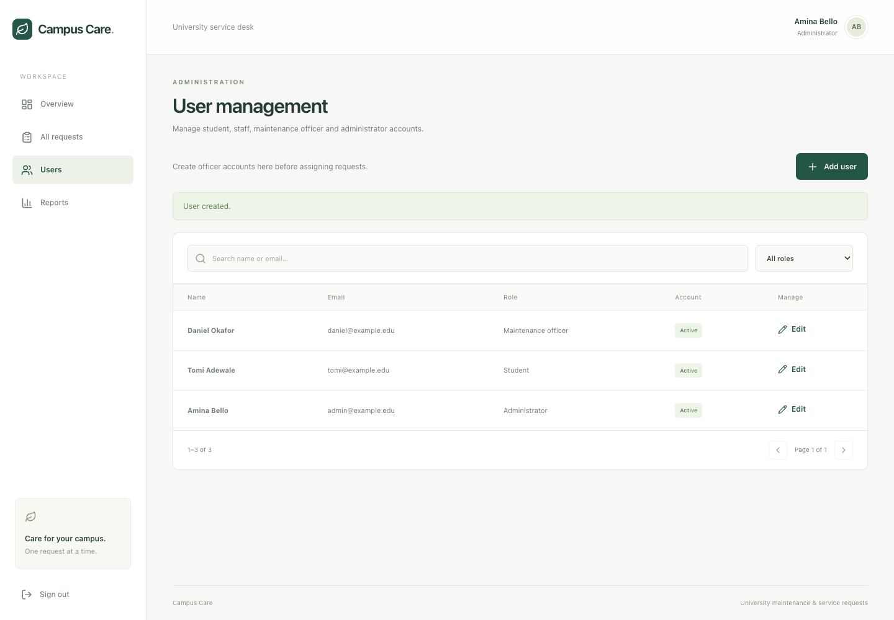

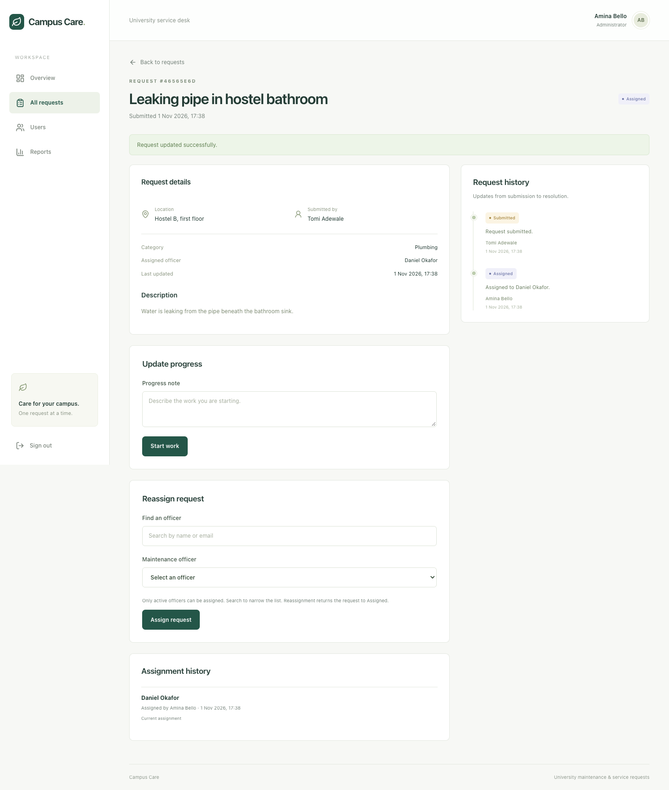

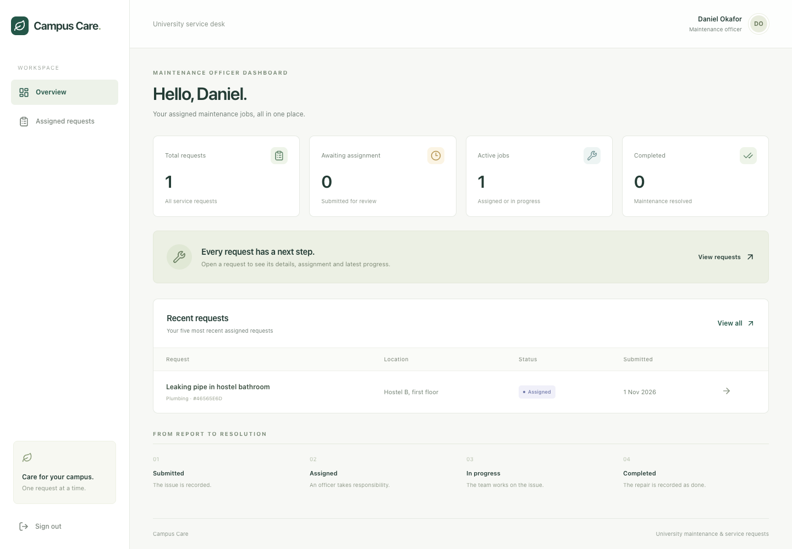

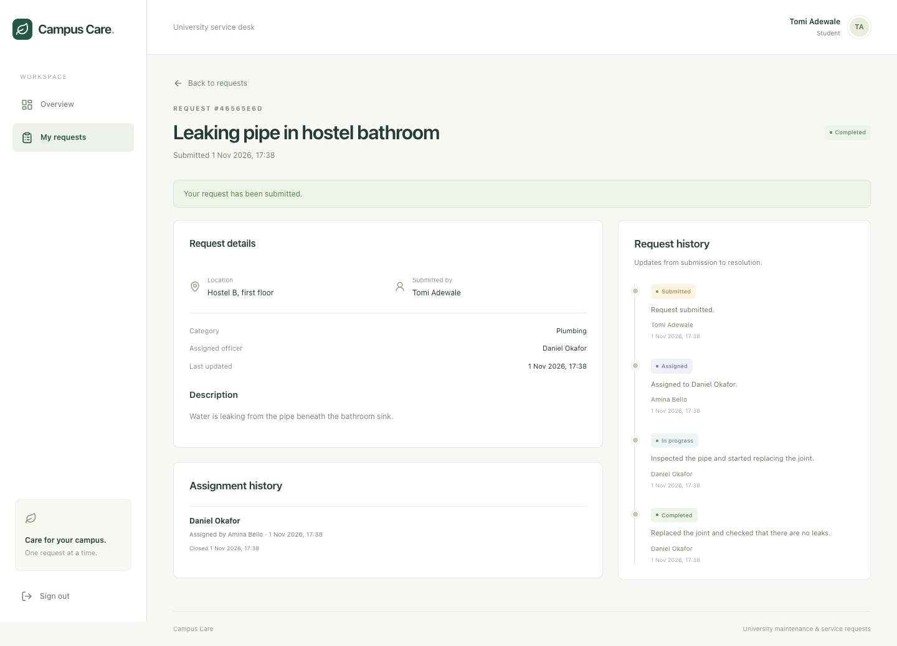

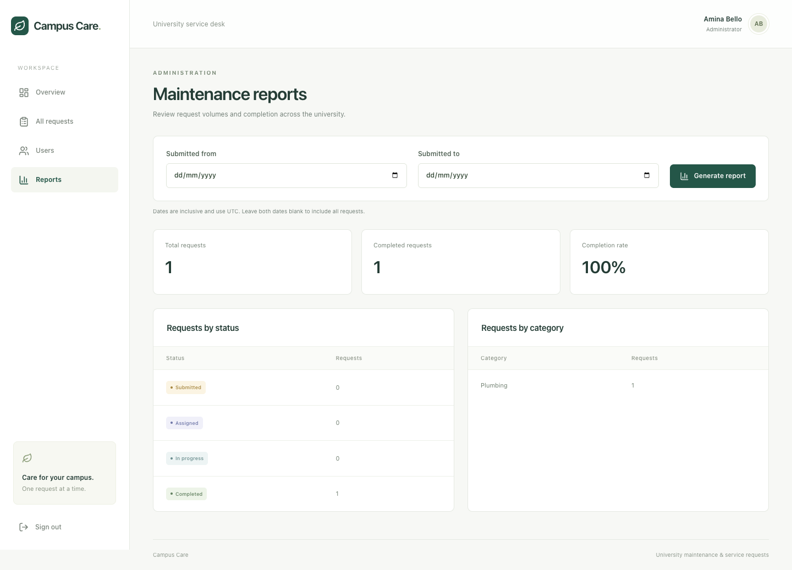

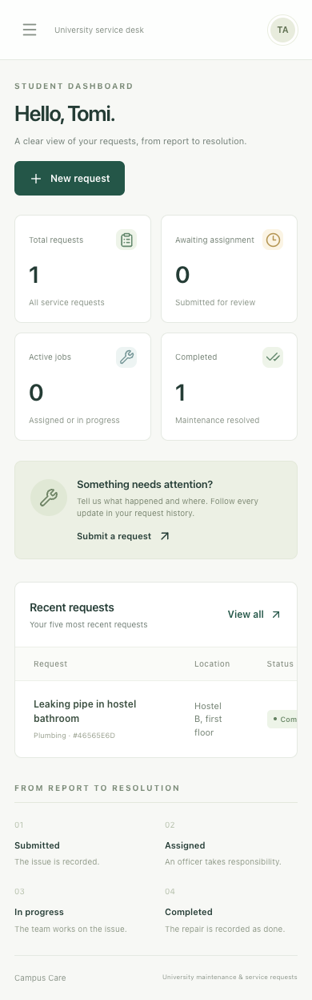

## 9. Testing evidence

Verification commands and actual outcomes are recorded in
[testing.md](testing.md). Tests use a dedicated PostgreSQL database ending in
`_test`, separate from application data.

Frontend component tests cover form validation and API errors, status labels,
empty results, tracking links, and pagination limits. Backend integration tests
exercise real HTTP endpoints, sessions, permissions, request CRUD, assignment,
progress transitions, concurrent updates, user management, and reports. Browser
tests exercise the complete three-role workflow and capture the interface output.

Local testing does not establish successful public deployment; online checks
are recorded separately after hosting is configured.

## 10. Deployment information

The production build serves the React client and REST API from one Node.js
service, backed by PostgreSQL. A Dockerfile and provider-independent deployment
instructions are in the repository. The application runs schema migrations
before accepting traffic; `/api/health` queries PostgreSQL.

**Online deployment remains pending.** Add the live URL, hosting provider,
database provider, deployment date, tested commit, health response, and online
workflow evidence after completing [deployment.md](deployment.md).

## 11. Challenges and solutions

- **Preventing cross-user access:** Central role guards and request ownership
  checks restrict student and officer visibility on the server.
- **Consistent assignment and progress history:** Transactions, row locks, and a
  unique active-assignment index protect state changes. Reassignment revokes the
  previous officer’s request access.
- **Role changes affecting active work:** Administrators must reassign unfinished
  officer work before disabling or changing that officer’s role. Session records
  are revoked when roles change or accounts are disabled.
- **Frontend and backend development origins:** Vite proxies `/api` locally;
  production serves both from the same origin, simplifying cookie authentication.
- **Reproducible tests without touching application data:** Tests explicitly
  require a separate database ending in `_test` before resetting its schema.

## 12. Conclusion

Campus Care implements the university maintenance workflow with role-based
interfaces, persistent request records, accountable assignment history, progress
tracking, and administrator reporting. The final submission must include verified
test results, the deployed application details, the GitHub link, and the complete
source-code appendix. Deployment and submission packaging must be completed
before claiming that every assessment requirement is satisfied.
